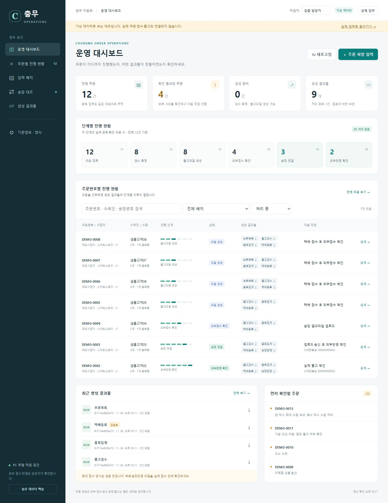

# 충무 프로젝트

주문 엑셀 입력부터 검수, 출고자료 생성, 송장 대조까지 처리하는 업무 자동화 MVP입니다. 주문번호별 진행 단계와 생성 결과물을 대시보드에서 추적합니다.

## 바로가기

**[GitHub Pages 대시보드 열기](https://namonu71.github.io/project_chungmu/index.html)** — 로그인 없이 `index.html`로 접속합니다.

GitHub Pages 버전은 가상 주문으로 시작하는 브라우저 체험판입니다. 검수·결과물 생성·송장 대조를 체험할 수 있으며, 데이터와 생성 파일은 이 브라우저에만 저장됩니다. [GitHub Pages 안내](pages/README.md)

**[실제 업무용 웹앱 열기](https://chungmu-order-operations.peppyagate1.chatgpt.site)**

웹사이트는 본인 전용 비공개로 배포되어 있으며, 사이트 소유자의 ChatGPT 계정으로 로그인합니다. 첫 화면은 개인정보가 없는 가상 주문 12건으로 구성됩니다. 실제 업무 공간은 데모와 별도로 저장합니다.

이 GitHub 저장소에서는 프로젝트 소스코드와 문서를 확인할 수 있습니다. 실행 중인 웹 앱은 위 대시보드 링크에서 접속합니다.



## 주요 기능

- 주문 XLSX 입력, 사업자·판매처·상품코드·옵션 매핑
- 필수값 누락, 미매핑, 가공 의심, 박스 용량 초과 등의 보류 처리
- 개별 및 정상 주문 일괄 검수, 수정 사유와 처리 이력 기록
- 출고검수·품목별집계·택배등록·보류목록 XLSX 생성
- 송장 결과파일 자동 대조 및 근거를 기록하는 직접 연결
- 중복 입력·중첩 주문·중복 송장 방지, 생성 후 변경 버전 관리
- 주문번호별 단계, 결과물 다운로드, 다음 작업 표시
- 외부접수·외부반영·실제 출고 각각 확인, 데이터 백업

파일 생성은 외부 택배 접수나 실제 출고를 자동 수행하지 않습니다. 실제 운영 전에는 상품 기준정보와 현재 택배·사방넷 업로드 양식의 접수 호환성을 검증해야 합니다.

## 프로젝트 구성

| 경로 | 내용 |
|---|---|
| `automation/` | PC용 Python 서버, 주문 처리, SQLite 저장, XLSX 생성 |
| `automation/static/` | PC용 대시보드 화면 |
| `automation/tests/` | PC 업무·HTTP 자동 테스트 |
| `web/app/` | 웹 화면과 서버 API |
| `web/lib/` | 웹 주문 처리 및 D1·R2 저장 |
| `web/db/`, `web/drizzle/` | 웹 DB 스키마·마이그레이션 |
| `web/public/` | 웹 대시보드 정적 자산 |
| `web/tests/` | 웹 업무 로직 자동 테스트 |
| `샘플/` | 빈 입력 양식과 개인정보 없는 가상 데이터 |
| `docs/` | 화면 미리보기 |

## PC에서 실행

Python 3.11 이상에서 다음을 실행합니다.

```bash
python -m pip install -r requirements.txt
python -m automation.launch
```

브라우저에서 `http://127.0.0.1:8765`로 접속합니다. 이 프로젝트를 처음 만든 Windows PC에서는 `실행.cmd`와 `종료.cmd`도 사용할 수 있습니다.

```bash
python -m unittest discover -s automation/tests -v
```

## 웹 버전 개발

Node.js 22.13 이상과 pnpm 11.25.0을 사용합니다.

```bash
cd web
pnpm install --frozen-lockfile
pnpm run db:generate
pnpm run build
```

기존 마이그레이션이 이미 있으면 스키마 변경이 없는 한 다시 생성할 필요가 없습니다. 로컬 D1을 처음 준비할 때 빌드한 다음 아래 명령을 한 번 실행합니다.

```bash
node --import ./scripts/sites-env.mjs ./node_modules/wrangler/bin/wrangler.js d1 execute DB --local --config dist/server/wrangler.json --persist-to .wrangler/state --file drizzle/0000_odd_george_stacy.sql
pnpm start
```

출력된 로컬 주소로 접속합니다. 업무 테스트는 다음과 같습니다.

```bash
node --test tests/operations.test.mjs
```

웹 버전은 Cloudflare Worker 실행 환경을 사용하고, D1에 주문·상태·이력을, R2에 원본·결과물을 보관합니다. Sites를 통해 배포한 현재 웹사이트와 PC 앱은 자동으로 데이터를 동기화하지 않습니다.

## 검증

- PC 자동 테스트 26개 통과
- 웹 업무 로직 테스트 14개 통과
- 배포된 웹사이트에서 가상 주문 저장·조회와 XLSX 다운로드 확인
- 중복 출고, 송장 오연결, 생성 후 변경, 실제/데모 저장소 분리 검증

테스트 데이터는 모두 가상 데이터입니다. 원본 업무자료, 고객정보, 실행 DB, 계정·인증정보와 생성 결과물은 저장소에 포함하지 않습니다.

## 사용 문서

- [사용 안내](사용안내.md)
- [MVP 구현 결과](구현결과.md)

일반 무가공·단일 박스 주문이 MVP 대상입니다. 생산·재고 실시간 연동, 자수·시안 관리, MES·이카운트 자동 등록과 여러 사용자 공동 운영은 후속 범위입니다.
